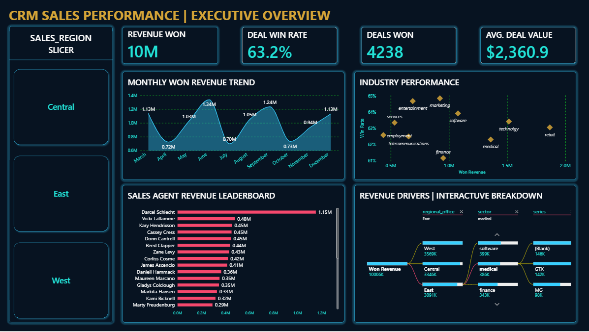
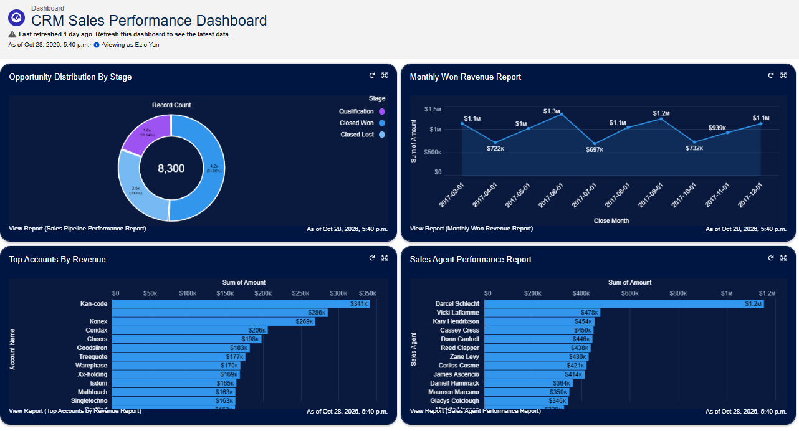
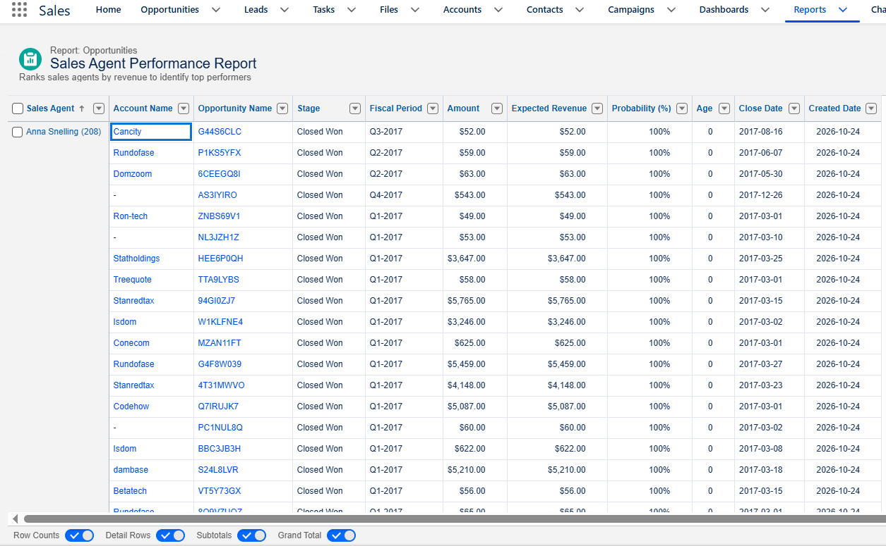
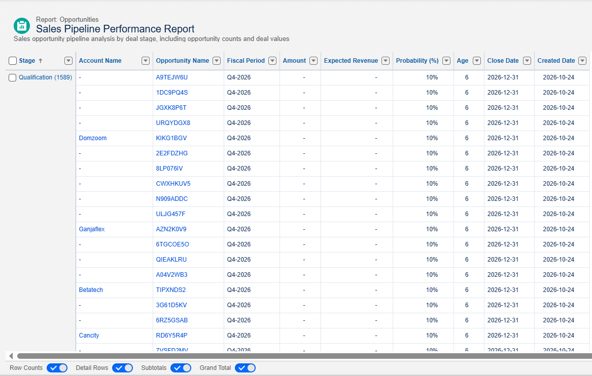
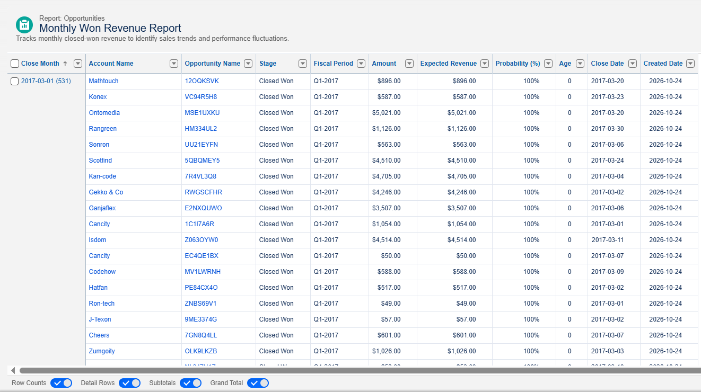
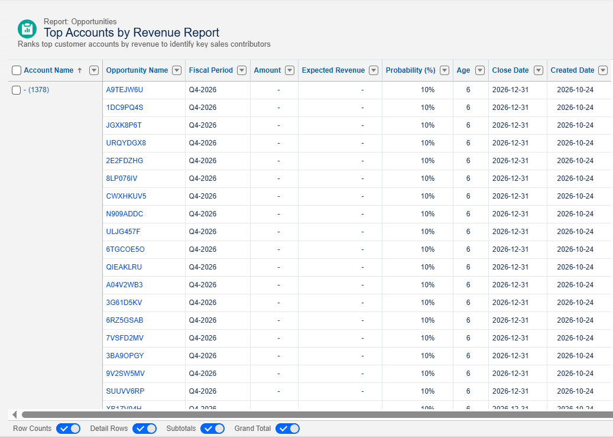

# CRM Sales Performance Analytics
### End-to-End Sales Analytics | MySQL · Salesforce CRM · Power BI

An end-to-end CRM sales analytics project combining relational database analysis, Salesforce reporting, and interactive Power BI visualization to evaluate revenue performance, sales pipeline efficiency, customer segments, and sales agent productivity.

## Executive Dashboard

<!-- Power BI Executive Dashboard -->

## Key Performance Indicators

| KPI | Result |
|---|---:|
| Total Won Revenue | $10.01M |
| Closed-Deal Win Rate | 63.2% |
| Won Opportunities | 4,238 |
| Average Won Deal Value | $2,360.90 |

**Win Rate Definition:** Won opportunities divided by all closed opportunities (Won + Lost). Open qualification-stage opportunities are excluded.

## Project Objectives

- Evaluate sales revenue, deal conversion, and monthly performance.
- Identify top-performing sales agents, accounts, products, and industries.
- Examine regional revenue distribution and sales performance.
- Investigate unmatched account records and data quality.
- Build operational reporting in Salesforce and an interactive executive dashboard in Power BI.

## Data Architecture & Workflow

**CRM CSV Data → MySQL Database → SQL Analysis → Salesforce Reporting + Power BI Dashboard**

Four source datasets were used:

| Dataset | Purpose |
|---|---|
| accounts.csv | Customer information, industry, and business characteristics |
| products.csv | Product catalog and pricing |
| sales_teams.csv | Sales agents, managers, and regional offices |
| sales_pipeline.csv | Opportunities, deal stages, engagement dates, closing dates, and deal values |

The sales pipeline is linked to accounts, products, and sales teams through their respective business identifiers.

## SQL Analytics

MySQL was used to create relational tables, validate records, calculate performance metrics, and analyze CRM data.

**Core analyses:**
1. Database and record-count validation
2. Total won revenue, closed-deal win rate, and average deal value
3. Monthly won revenue and deal trends
4. Opportunity distribution by pipeline stage
5. Sales agent performance and conversion rates
6. Product-level revenue analysis
7. Customer and industry performance using LEFT JOIN
8. Unmatched customer-account investigation
9. Regional performance using sales-team relationships
10. Sales cycle duration using date calculations

**SQL techniques:** CREATE TABLE, ALTER TABLE, SELECT, JOIN, GROUP BY, CASE WHEN, aggregate functions, NULLIF, CAST, DATE_FORMAT, DATEDIFF, and STR_TO_DATE.

See the SQL scripts in this repository for the implementation.

## Salesforce CRM Implementation

CRM datasets were imported into Salesforce objects and used to build reports and a sales performance dashboard.

### Salesforce Dashboard

<!-- Salesforce Dashboard -->

The dashboard includes opportunity stage distribution, monthly won revenue, top customer accounts, and sales agent performance.

### Sales Agent Performance

<!-- Sales Agent Performance -->

Ranks sales agents using opportunity and revenue data.

### Sales Pipeline Performance

<!-- Sales Pipeline Performance -->

Examines opportunities across pipeline stages.

### Monthly Won Revenue

<!-- Monthly Revenue Report -->

Tracks closed-won sales performance across reporting months.

### Top Customer Accounts

<!-- Top Customer Accounts -->

Supports account-level revenue concentration analysis.

## Power BI Executive Dashboard

<!-- Power BI Executive Dashboard -->

The interactive Power BI report includes:

- Revenue, win rate, won deals, and average deal value KPI cards
- Monthly won revenue area chart
- Industry revenue and win-rate comparison
- Sales agent revenue leaderboard
- Regional slicer
- Decomposition tree for investigating revenue drivers

## Business Insights & Findings

### 1. Revenue and Conversion

The dataset contains **8,800 opportunities**, including **4,238 won deals** generating **$10,005,534 in revenue**. The average won deal value is **$2,360.91**, while the closed-deal win rate is **63.2%**.

### 2. Industry Performance

**Retail** is the largest revenue-generating industry, producing **$1,867,528** from **799 won deals**. Technology (spelled `technolgy` in the source dataset) ranks second with **$1,515,487**, followed by Medical with **$1,359,595**.

**Marketing** achieves the highest closed-deal win rate at **64.85%**, followed by Entertainment at **64.68%**. This illustrates that the industry generating the most revenue is not necessarily the industry with the strongest conversion efficiency.

### 3. Sales Agent Performance

**Darcel Schlecht** is the leading sales agent by won revenue, generating **$1,153,214** across **349 won opportunities**. Vicki Laflamme follows with **$478,396**, and Kary Hendrixson with **$454,298**.

Darcel contributes approximately **11.5%** of total won revenue, demonstrating meaningful concentration among the highest-performing agents.

### 4. Regional Revenue Distribution

The **West** region leads with **$3,568,647** in won revenue, followed by **Central ($3,346,293)** and **East ($3,090,594)**. The regional dashboard slicer allows management to investigate differences in revenue drivers and sales-agent contributions.

## Tools & Technical Skills

| Tool | Application |
|---|---|
| MySQL Workbench | Database creation, SQL queries, joins, aggregation, validation |
| Salesforce CRM | Data import, objects, operational reports, dashboards |
| Power BI | Data modelling, DAX measures, KPI cards, slicers, executive dashboard |
| Excel / CSV | Source data preparation and import |

## Repository Contents

- SQL scripts: database setup and sales performance analysis
- CSV datasets: accounts, products, sales teams, and sales pipeline
- Screenshots: Salesforce reports, Salesforce dashboard, Power BI executive dashboard

  
